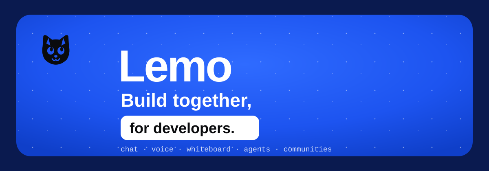
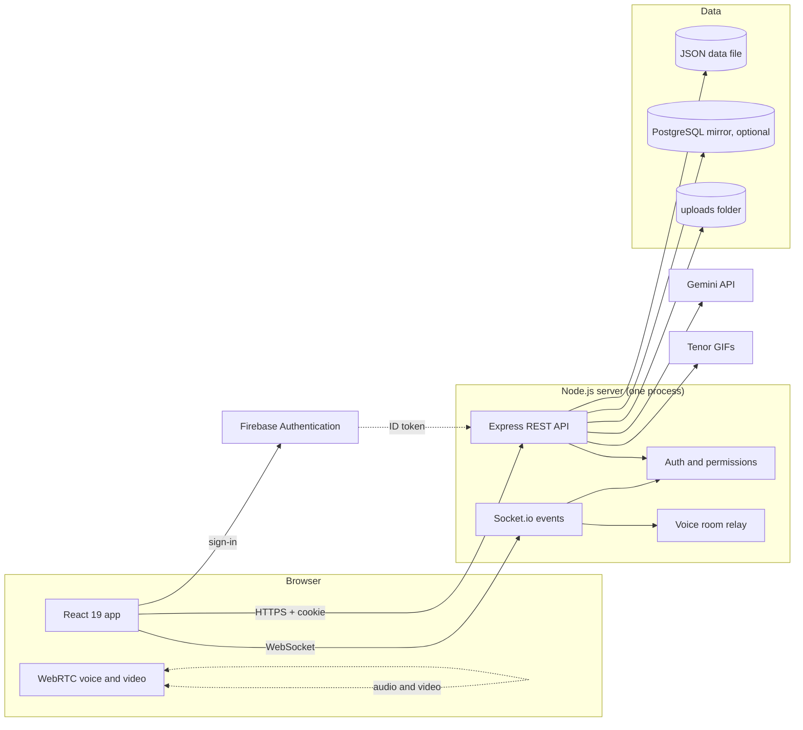
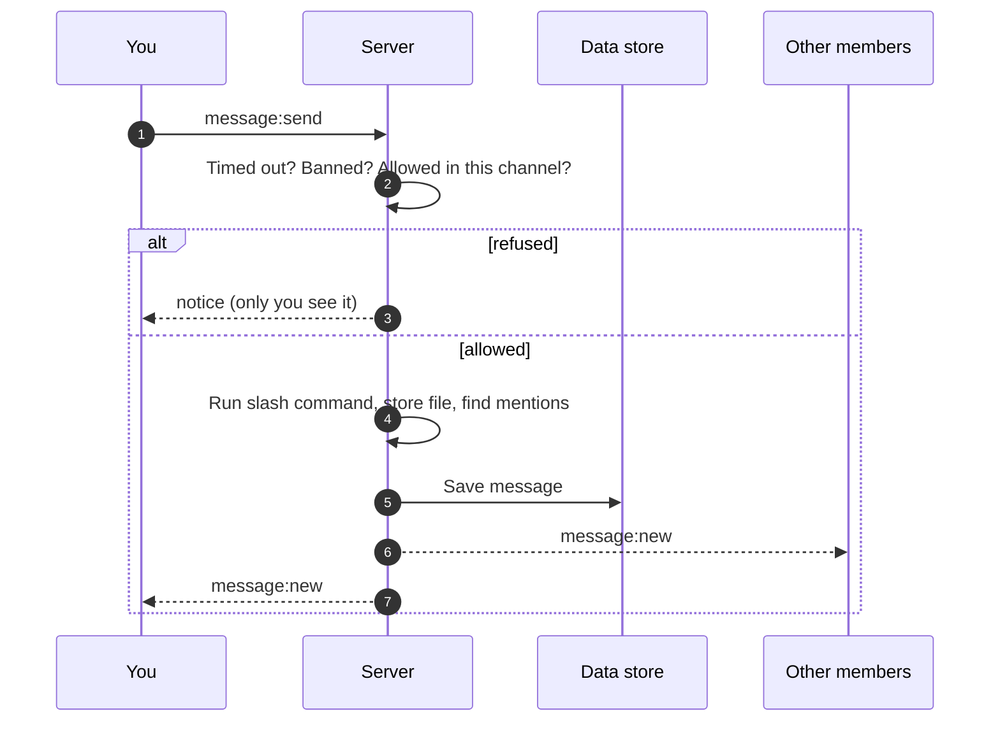

<div align="center">



<br>

**A live workspace for developer teams.**
Chat, voice, communities with roles, a shared whiteboard and a visual AI agent builder, in one place.

<br>


</div>

<br>

<table align="center">
  <tr>
    <td align="center" width="20%"><a href="#-features"><b>Features</b></a></td>
    <td align="center" width="20%"><a href="#-getting-started"><b>Get started</b></a></td>
    <td align="center" width="20%"><a href="#%EF%B8%8F-configuration"><b>Configuration</b></a></td>
    <td align="center" width="20%"><a href="#-architecture"><b>Architecture</b></a></td>
    <td align="center" width="20%"><a href="#-contributing"><b>Contributing</b></a></td>
  </tr>
</table>

---

## ✨ Why Lemo

Most team tools make you live in several apps: one for talking, one for calls, one for diagrams, one for automation. Lemo brings them into one screen, connected live.

| | |
|:--|:--|
| 💬 **Talk** | Channels, threads, DMs, replies, edits, mentions, GIFs and link previews |
| 🎙️ **Call** | Voice and video channels that connect people directly in the browser |
| 🏘️ **Organise** | Communities with owners, roles, permissions, invites, bans and private channels |
| 🎨 **Sketch** | A shared whiteboard with live strokes and cursors |
| 🤖 **Automate** | A visual agent studio that chains Gemini, search, JavaScript and webhooks |
| 🛡️ **Trust** | Firebase sign-in, sessions in HttpOnly cookies, rate limits and an audit log |

---

## 🧭 Features

<details open>
<summary><b>💬 Chat</b></summary>

- Channels, direct messages, threads, reactions, pins and presence
- **Replies** that quote the original message, and **edits** marked *(edited)*
- **@mentions** that highlight the message and notify the person mentioned
- Markdown, fenced code blocks and snippets, with a **Run** button for JavaScript (sandboxed in a Web Worker)
- **Attachments** of any type up to 500 KB; images show inline, other files download
- **GIF search** through Tenor, when a key is configured
- **Link previews** for the first web link in a message, from public pages only
- **Search**, **history paging** and an emoji palette

</details>

<details>
<summary><b>🏘️ Communities</b></summary>

- Create a community and you become its **owner**
- **Roles** with names, colours and permissions: Owner, Admin, Moderator and Member, plus custom roles
- **Invite links** that can be reset at any time
- **Private channels** that only chosen roles can see, join or post in
- **Bans** with a reason, and an unban list
- Members grouped by role, with controls to hand out roles and remove people

</details>

<details>
<summary><b>🎙️ Voice and video</b></summary>

- Voice and video channels for any community
- The server only relays connection setup; audio and video travel directly between browsers
- Mute, camera and leave controls, with a tile for each person
- STUN is built in; add TURN with `VOICE_ICE_SERVERS` for strict networks

</details>

<details>
<summary><b>🎨 Whiteboard</b></summary>

One shared board: select and move, pen, rectangle, ellipse, line, arrow, text and a real eraser. Live strokes and cursors, pan and zoom, undo for your own shapes, and PNG export.

</details>

<details>
<summary><b>🤖 Agent studio</b></summary>

Build workflows on a canvas from five step types and run them:

| Step | What it does |
|:--|:--|
| **Trigger** | Starts a run with a test input, available as `{{trigger.message}}` |
| **Gemini** | Calls Gemini with your prompt, system instruction and temperature |
| **Web search** | Gemini grounded on Google Search, with a summary and cited sources |
| **JavaScript** | Runs your script in an isolated worker (4 s limit) to reshape data |
| **Action** | Posts into a channel as the agent, or to an https webhook |

Steps refer to earlier output with `{{prev}}` or `{{<stepId>.result}}`. Three templates are included.

</details>

<details>
<summary><b>🛡️ Moderation and friends</b></summary>

- Send friend requests by username, accept, decline, remove and block
- Admins can **time out** members, **ban** them with a reason, and **delete** any message
- Community moderators can delete messages in their own communities
- Every moderation action is written to an **audit log**

</details>

<details>
<summary><b>⌨️ Console, dashboard and profile</b></summary>

- **Overview dashboard** with live activity, favourites, your channels and your XP
- **Console** (<kbd>Ctrl</kbd> + <kbd>`</kbd>): `whoami`, `users`, `channels`, `events`, `stats`, `ai <prompt>`
- **Command palette** (<kbd>Ctrl</kbd> + <kbd>K</kbd>)
- **Slash commands** in chat: `/roll 2d6`, `/poll Question | A | B`, `/shrug`, `/me waves`, `/help`
- Profile editing, light and dark themes, and a Free / Pro / Enterprise upgrade flow

</details>

<details>
<summary><b>🔐 Accounts</b></summary>

- **Firebase Authentication**: email and password, and Google sign-in
- Existing username and password accounts keep working
- Sessions live in an **HttpOnly, SameSite=Strict cookie**; signing out ends every session
- Sign-in and sign-up are rate limited per IP address

</details>

---

## 🚀 Getting started

**Requirements:** Node.js 20 (18 works).

```bash
git clone https://github.com/arg0506/Devpulse.git
cd Devpulse
npm install
cp .env.example .env     # optional: add keys for AI, GIFs and Firebase
npm run dev
```

Open **http://localhost:3000**, create an account and say hello in `#general`.

> The first account created is the workspace admin. To choose admins yourself, set `LEMO_ADMINS`.

<details>
<summary><b>🔥 Firebase sign-in setup</b></summary>

1. In the Firebase console, open **Authentication → Sign-in method** and enable **Email/Password** and **Google**.
2. Under **Authentication → Settings → Authorized domains**, add the domain you serve Lemo from. `localhost` is there by default.
3. Keep your project's web configuration in `frontend/lib/firebase.ts`. These values identify the project and are meant to be public; access is controlled by the console settings above.
4. Set `FIREBASE_PROJECT_ID` on the server if your project is not `lemo-04`.

The server does not need a Firebase service key. It checks each sign-in token against Google's published certificates, along with the issuer, audience and expiry.

</details>

---

## ⚙️ Configuration

Every variable is optional for local development. See [`.env.example`](.env.example).

| Variable | Purpose |
|:--|:--|
| `PORT` | Port for the combined API and web server (default `3000`) |
| `JWT_SECRET` | Signs session tokens. **Required in production**: the server will not start without it |
| `LEMO_ADMINS` | Comma-separated usernames who can moderate the whole workspace |
| `FRONTEND_URL` | Origin allowed to open socket connections. Unset means same-origin only |
| `FIREBASE_PROJECT_ID` | Firebase project whose sign-in tokens are accepted (default `lemo-04`) |
| `GEMINI_API_KEY` | Enables `@gemini` replies, the console `ai` command and Gemini steps |
| `GEMINI_MODEL` | Overrides the Gemini model (default `gemini-3.5-flash`) |
| `TENOR_API_KEY` | Turns on the GIF picker |
| `VOICE_ICE_SERVERS` | JSON list of STUN/TURN servers for voice calls |
| `DATABASE_URL` | PostgreSQL connection string; users, messages, communities and events are mirrored |
| `DEVPULSE_DATA_FILE` | Path to the JSON data file (default `backend-data.json`) |
| `LEMO_UPLOAD_DIR` | Folder for uploaded files (default `uploads/`) |
| `STRIPE_SECRET_KEY` | Switches checkout from demo mode to Stripe |

<details>
<summary><b>🐘 Using PostgreSQL</b></summary>

```bash
npm run db:generate
npm run db:push
```

PostgreSQL is an optional mirror. The JSON file stays the source of truth for the live workspace.

</details>

---

## 📜 Scripts

| Command | What it does |
|:--|:--|
| `npm run dev` | Development server with hot reload |
| `npm run build` | Builds the client and bundles the server |
| `npm start` | Runs the production build (needs `JWT_SECRET`) |
| `npm run lint` | Type-checks the whole project |
| `npm test` | Runs the test suite (49 tests) |

---

## 🏗️ Architecture



### How a message travels



### Project layout

```text
Devpulse/
├── server.ts                 Express app, Socket.io, Vite (dev) or static files (prod)
├── backend/
│   ├── db.ts                 JSON store with atomic saves and backups
│   ├── sockets.ts            Real-time events and their permission checks
│   ├── firebaseAuth.ts       Firebase token verification (no service key)
│   ├── voice.ts              Voice room membership and signalling
│   ├── linkPreview.ts        Safe link previews (public addresses only)
│   ├── gifs.ts               Tenor GIF search
│   ├── uploads.ts            File storage and serving
│   ├── middleware/           Authentication and rate limiting
│   └── routes/               Auth, communities, events, payments, agents
├── frontend/
│   ├── lib/permissions.ts    Community permission rules, shared with the server
│   ├── lib/firebase.ts       Firebase client
│   └── components/           Landing page, auth, workspace, communities, voice
├── tests/                    Unit tests for the core rules
├── docs/                     API reference, diagrams and illustrations
└── src/index.css             Design tokens and motion
```

---

## 🎨 Design

The landing page and login use a blue stage, white cards, black ink and soft illustrations. The workspace uses a Discord-style dark palette, with a server rail, a channel list, a user panel and a member column. The logo is a black cat face whose colour follows the background.

---

## 🔐 Security

- Sessions are **HttpOnly, SameSite=Strict** cookies, so page scripts cannot read them.
- Every REST call and socket connection is checked; banned accounts are refused at connection time.
- Permissions are checked on the server for every role, invite, channel and moderation action.
- Passwords are hashed with bcrypt. Firebase sign-ins are verified against Google's signing certificates.
- Link previews only fetch public addresses, including after redirects.
- Uploads are served with `nosniff` and a sandboxed content policy. HTML and SVG uploads are refused.
- Responses carry baseline headers; the socket server only accepts the configured origin.

Please report vulnerabilities through a private GitHub security advisory, not a public issue.

---

## 🚧 Known limitations

- **Voice is a mesh.** Each browser connects to every other person, so it suits small groups. Strict networks need a TURN server.
- **Attachments are local files.** Larger files or several servers would need object storage.
- **The JSON file is the source of truth.** PostgreSQL is a mirror, not the primary store.
- **Scheduled and webhook agent triggers** need a server-side runner that is not built yet.
- **Live Stripe checkout** needs the Stripe Payment Element before it can take real payments.
- **No accessibility audit yet.**

---

## 🤝 Contributing

Contributions are welcome. Read [`CONTRIBUTING.md`](CONTRIBUTING.md) for setup, ground rules and how to add an endpoint. The REST and socket reference is in [`docs/API.md`](docs/API.md).

---

## 📄 License

Released under the **MIT License**. See [`LICENSE`](LICENSE).

<div align="center">
<br>

</div>
