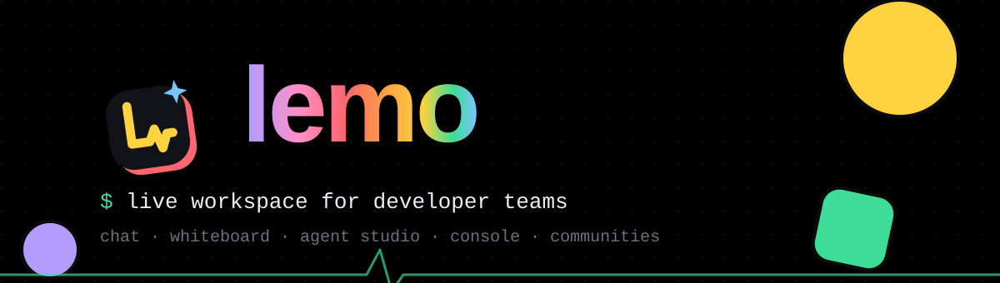
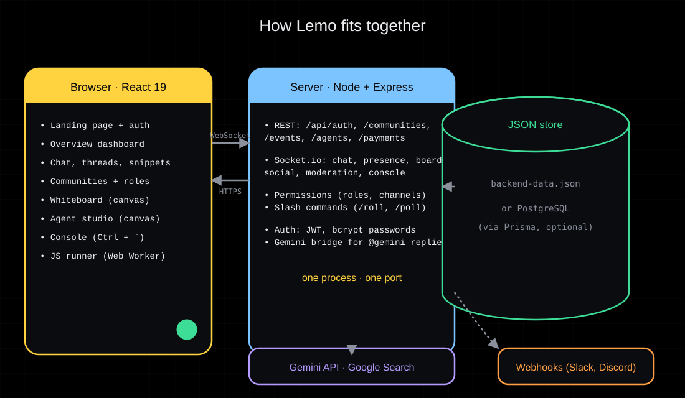
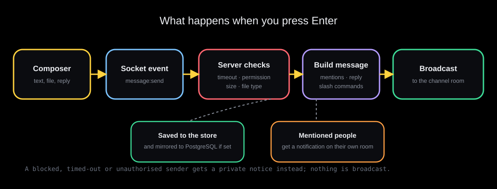
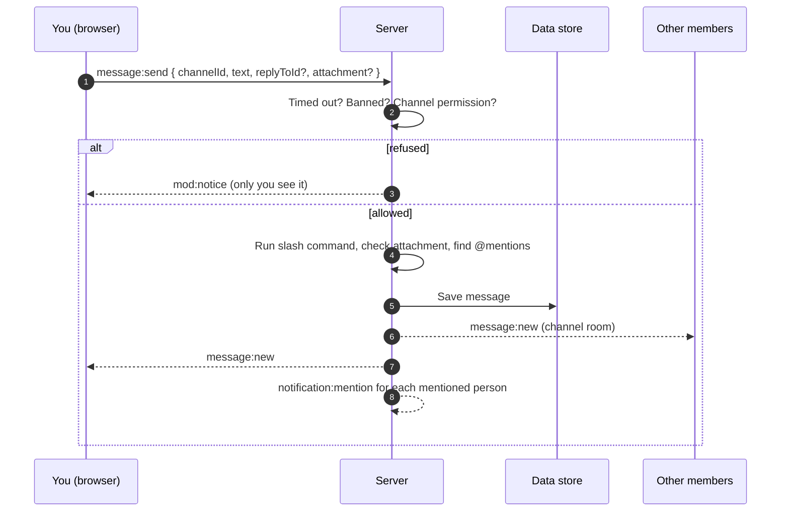
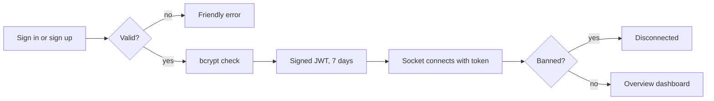
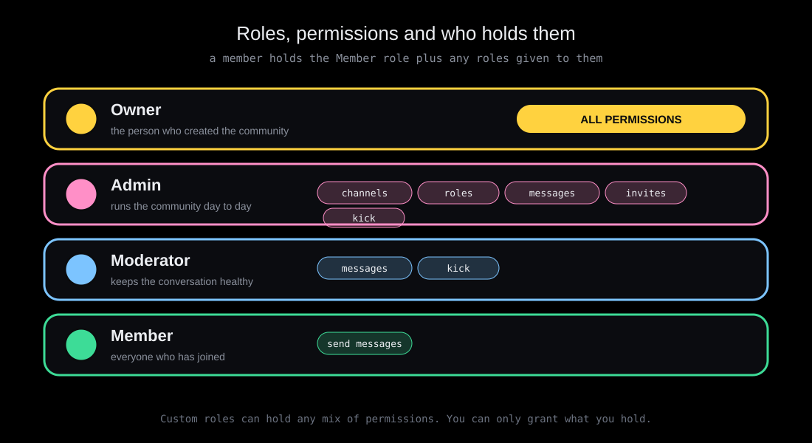
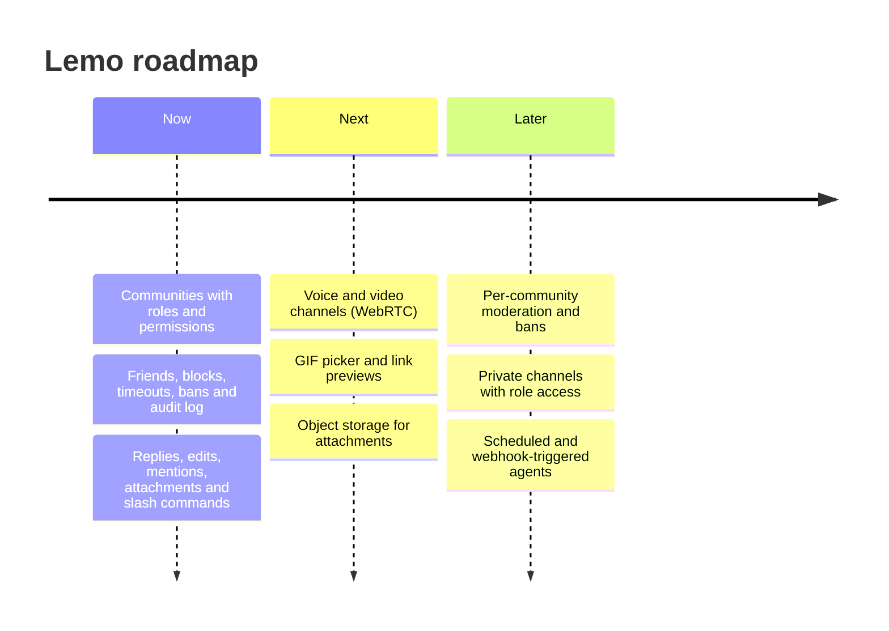

<p align="center">
  
</p>

<h1 align="center">Lemo</h1>

<p align="center">
  <b>A live workspace for developer teams.</b><br>
  Chat, communities with roles, a shared whiteboard, a visual AI agent builder and a command console,<br>
  side by side. Every change reaches your team the moment it happens.
</p>

<p align="center">
  
  
  
  
  
  
  
</p>

---

## Table of contents

1. [Why Lemo](#-why-lemo)
2. [Feature tour](#-feature-tour)
3. [Architecture](#-architecture)
4. [How a message travels](#-how-a-message-travels)
5. [Roles and permissions](#-roles-and-permissions)
6. [Slash commands](#-slash-commands)
7. [Quick start](#-quick-start)
8. [Configuration](#-configuration)
9. [Scripts](#-scripts)
10. [Project structure](#-project-structure)
11. [Design system](#-design-system)
12. [Security](#-security)
13. [Known limitations](#-known-limitations)
14. [Roadmap](#-roadmap)
15. [License](#-license)

---

## ✨ Why Lemo

Most team chat tools keep you in one tab for talking, another for diagrams, another for automations and a fourth for the console you actually use to ship. Lemo puts them on one screen, in one live connection:

| | |
|---|---|
| 💬 **Talk** | Channels, DMs, threads, replies, edits, mentions, reactions, pins and code snippets you can run |
| 🏘️ **Organise** | Communities with channels, roles, permissions and invite links |
| 🎨 **Sketch** | A shared whiteboard with live strokes and cursors |
| 🤖 **Automate** | A visual agent studio that chains triggers, Gemini, search, JavaScript and webhooks |
| ⌨️ **Command** | A console (<kbd>Ctrl</kbd> + <kbd>`</kbd>) and command palette (<kbd>Ctrl</kbd> + <kbd>K</kbd>) |
| 🛡️ **Moderate** | Friends, blocking, timeouts, bans and an audit log |

---

## 🧭 Feature tour

### 🏠 Overview dashboard
The first screen you see after signing in. It shows how many messages arrived in the last five minutes, a live activity chart, your favourite channels, the people online, and your XP and streak. Every number comes from the live workspace.

### 💬 Chat
- Channels, direct messages and threads
- **Replies** with a quote of the original message
- **Edit** your own messages (Enter to save, Escape to cancel), marked *(edited)*
- **@mentions** highlight the message for the person mentioned and send them a notification
- **Reactions**, **pins**, typing indicators, presence and unread badges
- Markdown, fenced code blocks, and shared snippets with a **Run** button for JavaScript (sandboxed in a Web Worker)
- **Attachments** of any type up to 500 KB. Images show inline; other files download. HTML and SVG are blocked
- **Emoji palette** and message search

### 🏘️ Communities (servers)
- Create a community and you become its **owner**
- **Roles** with names, colours and permissions, plus built-in Owner, Admin, Moderator and Member roles
- **Invite links** you can reset at any time
- Channels that belong to a community, with the permission to post in them checked on every message
- Members **grouped by role**, with toggles to hand out roles and a button to remove people

### 🎨 Whiteboard
One board shared by everyone: select and move, pen, rectangle, ellipse, line, arrow, text and a real eraser. Live strokes and cursors, pan and zoom, undo for your own shapes, PNG export.

### 🤖 Agent studio
Build workflows on a canvas from five step types and run them:

| Step | What it does |
|---|---|
| **Trigger** | Starts a run with a test input, available as `{{trigger.message}}` |
| **Gemini** | Calls Gemini with your prompt, system instruction and temperature |
| **Web search** | Gemini grounded on Google Search, with a summary and cited sources |
| **JavaScript** | Runs your script in an isolated worker (4 s limit) to reshape data |
| **Action** | Posts into a Lemo channel as the agent, or to an https webhook (Slack, Discord, anything) |

Steps reference earlier output with `{{prev}}` or `{{<stepId>.result}}`. Three templates are included.

### 📅 Events
Schedule an event with a date, a call link and a community. People RSVP, and each event opens a discussion channel.

### 🧑‍🤝‍🧑 Friends and moderation
- Send friend requests by username, accept or decline them, and remove friends
- **Block** someone and their messages disappear from your chat
- Admins can **time out** a member (10 minutes, lifted early if needed), **ban** with a reason, and **delete** any message
- Every moderation action is written to an **audit log**

### ⌨️ Console
Press <kbd>Ctrl</kbd> + <kbd>`</kbd> from anywhere: `whoami`, `users`, `channels`, `events`, `stats`, `ai <prompt>`, with history and tab completion.

### 🎟️ Accounts and plans
Email or username sign-up with JWT sessions, profile editing (avatar, role, skills, status, bio, GitHub), light and dark themes, and a Free / Pro / Enterprise upgrade flow.

---

## 🏗️ Architecture



Lemo is **one Node process on one port**. Express serves the REST API and the built web app, Socket.io carries every live event, and a single JSON file (or optional PostgreSQL) holds the data.

| Layer | What lives there |
|---|---|
| **Client** | React 19 + Tailwind v4, one shared socket, a workspace context, canvas-based whiteboard and agent studio |
| **Server** | Express routes, Socket.io handlers, permission checks, slash commands, Gemini bridge |
| **Data** | `backend-data.json` by default; PostgreSQL through Prisma when `DATABASE_URL` is set |
| **External** | Gemini API (optional), webhooks for agent actions (optional), Stripe (optional) |

---

## 📨 How a message travels

Sending a message runs through a short list of checks on the server before anything is broadcast.





### Logging in



---

## 🛡️ Roles and permissions



| Permission | Lets a member… |
|---|---|
| `administrator` | Do everything, including every permission below |
| `manage_channels` | Create channels in the community |
| `manage_roles` | Create roles and give them to members (only permissions they hold) |
| `manage_messages` | Delete other members’ messages in the community’s channels |
| `manage_invites` | See and reset the invite link |
| `kick_members` | Remove members |
| `send_messages` | Post in the community’s channels |

Rules that keep the system honest:

- The **owner** can’t be removed, and their role can’t be changed
- You can only **grant permissions you hold** yourself
- **Built-in roles** can’t be deleted
- Members who aren’t in a community can’t post in its channels

---

## ⌨️ Slash commands

| Command | Result |
|---|---|
| `/roll 2d6` | Rolls dice and posts each result and the total (up to 20 dice, up to 100 sides) |
| `/poll Question \| A \| B` | Posts a numbered poll for people to vote on with reactions |
| `/shrug` | Adds a shrug emoticon after your text |
| `/me waves` | Posts an action in italics: *you waves* |
| `/help` | Lists the commands (only you see the reply) |

Commands are plain text transforms. They never run code and never reach outside the server.

---

## 🚀 Quick start

Requires **Node.js 18+**.

```bash
git clone https://github.com/arg0506/Devpulse.git
cd Devpulse
npm install
cp .env.example .env     # optional: add GEMINI_API_KEY for live AI
npm run dev
```

Open **http://localhost:3000**, create an account, and say hello in `#general`.

Run the checks with `npm run lint`, `npm test` and `npm run build`. A GitHub Actions workflow runs them on every push and pull request. The API is documented in [`docs/API.md`](docs/API.md), and [`CONTRIBUTING.md`](CONTRIBUTING.md) covers how to contribute.

> **Tip:** the first account created is the workspace admin. To choose admins yourself, set `LEMO_ADMINS` (see below).

---

## ⚙️ Configuration

All variables are optional for local development. See [`.env.example`](.env.example).

| Variable | Purpose |
|---|---|
| `PORT` | Port for the combined API and web server (default `3000`) |
| `JWT_SECRET` | Signs session tokens. **Required in production**: the server refuses to start without it |
| `LEMO_ADMINS` | Comma-separated usernames who can moderate the whole workspace. Defaults to the first account created |
| `GEMINI_API_KEY` | Enables `@gemini` replies, the console `ai` command and Gemini and search steps |
| `GEMINI_MODEL` | Overrides the model (default `gemini-3.5-flash`) |
| `DATABASE_URL` | PostgreSQL connection string. When reachable, users, messages, communities and events are mirrored with Prisma |
| `DEVPULSE_DATA_FILE` | Path to the JSON data file (default `backend-data.json`). The name is kept from the project’s first name |
| `FIREBASE_PROJECT_ID` | Firebase project whose sign-in tokens the server accepts (default `lemo-04`) |
| `STRIPE_SECRET_KEY` | Switches checkout from demo mode to Stripe (see [limitations](#-known-limitations)) |

To use PostgreSQL:

```bash
npm run db:generate
npm run db:push
```

---

## 🔥 Firebase sign-in

Lemo uses **Firebase Authentication** for email and password, and for Google sign-in. Firebase proves who someone is; Lemo keeps the profile, communities and sessions. Existing Lemo username and password accounts keep working.

To turn it on for your own project:

1. In the Firebase console, open **Authentication → Sign-in method** and enable **Email/Password** and **Google**.
2. Under **Authentication → Settings → Authorized domains**, add the domain you serve Lemo from (`localhost` is there by default).
3. Put your project's web configuration in `frontend/lib/firebase.ts`. These values identify the project and are meant to be public. Protect the project with the console settings above, not by hiding them.
4. Set `FIREBASE_PROJECT_ID` on the server if it differs from the default.

The server never needs a Firebase service key. It checks each sign-in token against Google's published signing certificates, along with the issuer, audience and expiry. A Firebase email that matches an existing Lemo account is linked only when Firebase has verified it.

## 📜 Scripts

| Command | What it does |
|---|---|
| `npm run dev` | Express and Socket.io with Vite middleware and hot reload |
| `npm run build` | Builds the client to `dist/` and bundles the server to `dist/server.cjs` |
| `npm start` | Runs the production build from the project root (needs `JWT_SECRET`) |
| `npm run lint` | Type-checks the whole project |
| `npm test` | Runs the test suite in `tests/` |
| `npm run db:generate` | Generates the Prisma client |
| `npm run db:push` | Pushes the Prisma schema to PostgreSQL |

---

## 🗂️ Project structure

```text
Devpulse/
├── server.ts                    Express app, REST routes, Socket.io, Vite (dev) or static files (prod)
├── backend/
│   ├── db.ts                    JSON store: users, credentials, channels, messages, communities, roles,
│   │                            friendships, blocks, timeouts, bans, audit log, workflows
│   ├── prismaClient.ts          Optional PostgreSQL mirror, created only when DATABASE_URL works
│   ├── sockets.ts               Real-time events: chat, threads, board, social, moderation, console
│   ├── gemini.ts                Gemini text generation and Google Search grounding
│   ├── realtime.ts              Shared Socket.io handle and presence broadcasting
│   ├── middleware/auth.ts       JWT signing and verification
│   └── routes/                  auth, communities (roles, invites, members), events, payments, agents
├── frontend/
│   ├── App.tsx                  Session restore and screen routing
│   ├── types.ts                 Shared data shapes
│   ├── lib/
│   │   ├── workspace.tsx        Workspace context: connection, channels, presence, unread, theme
│   │   ├── permissions.ts       Permission rules, shared by server and client
│   │   ├── markdown.tsx         Message rendering and the code block with Run
│   │   └── runCode.ts           Web Worker sandbox for JavaScript
│   └── components/
│       ├── LandingPage.tsx      Marketing page
│       ├── AuthScreen.tsx       Sign in and sign up
│       ├── Shell.tsx            Left rail, status bar, view switching
│       ├── OverviewView.tsx     Dashboard
│       ├── ChatWorkspace.tsx    Channels, messages, composer, threads, members
│       ├── CommunitiesView.tsx  Servers: roles, invites, channels, members
│       ├── SocialModal.tsx      Friends, requests, blocks and moderation tools
│       ├── EventsView.tsx       Events and RSVPs
│       ├── Whiteboard.tsx       Shared canvas
│       ├── AgentWorkflowBuilder.tsx  Agent studio canvas
│       └── Terminal.tsx         Command console
├── src/index.css                Design tokens for light and dark themes
├── docs/                        README illustrations
└── public/                      Static images served by Vite
```

---

## 🎨 Design system

The interface is built around an editor-inspired palette, where each colour plays the role of a syntax token:

| Colour | Used for |
|---|---|
|  Green `#3ddc97` | Strings, prompts, success |
|  Sky `#7cc4ff` | Functions, links |
|  Violet `#b49cff` | Keywords, AI |
|  Orange `#ff9f43` | Numbers |
|  Pink `#ff8fc7` | Tags, components |
|  Yellow `#ffd23f` | Highlights, the owner role |
|  Coral `#ff6670` | The accent and live signals |

Type is **Bricolage Grotesque** for headlines, **IBM Plex Sans** for reading and **IBM Plex Mono** for code, labels and data. Surfaces are near-black in dark mode, and the signature gradient runs through headline text, primary buttons and the footer wordmark. The heartbeat trace draws across the landing page and spikes whenever a message lands.

---

## 🔐 Security

- Sessions live in an **HttpOnly, SameSite=Strict cookie**, so page scripts cannot read them. Signing out ends the session on every device and disconnects its sockets.
- Sign-in and sign-up are rate limited per IP address. Banned accounts are refused at connection time.
- Responses carry `nosniff`, a frame-denial header and a referrer policy. The socket server only accepts the configured `FRONTEND_URL`, or same-origin connections when it is unset.
- The server builds every message from the authenticated user, so clients can’t impersonate anyone.
- Passwords are hashed with **bcrypt**. Credentials are stored apart from public profiles, and public user lists never include them.
- Permissions are checked on the server for every role, invite, membership, channel and moderation action. The client only hides buttons.
- Webhook actions only reach public https addresses.
- User JavaScript only ever runs in the browser, inside a Web Worker.
- Attachments can’t be HTML or SVG, since a browser can run scripts inside those files.
- In production the server will not start with the built-in development secret.

To report a vulnerability, please open a private security advisory on GitHub rather than a public issue.

---

## 🚧 Known limitations

- **Voice and video are not built yet.** They need a WebRTC setup, and calls across different networks also need a TURN server.
- **No GIF picker** until a Tenor or Giphy API key is configured.
- **No link previews.** Fetching arbitrary pages from the server needs a domain policy first.
- **Attachments are small** (500 KB) and are kept in a local `uploads/` folder. Object storage (such as S3) would be needed for larger files or several servers.
- **The JSON file is still the source of truth.** PostgreSQL is an optional mirror, so a single-server, single-file setup is the supported way to run Lemo today.
- **Live Stripe payments.** Without `STRIPE_SECRET_KEY`, checkout runs in demo mode. With a key, the server creates and verifies real PaymentIntents, but the card form still needs Stripe’s Payment Element before live checkout can be enabled.
- **Agent triggers run from the studio.** Scheduled and incoming-webhook triggers need a server-side runner.
- **One shared whiteboard** for the whole workspace.
- **Moderation is workspace-wide for admins.** Community moderators can delete messages in their own community, but there is no per-community ban yet.

---

## 🛣️ Roadmap



---

## 📄 License

Released under the **MIT License**. See the [`LICENSE`](LICENSE) file.

<p align="center">
  
</p>
